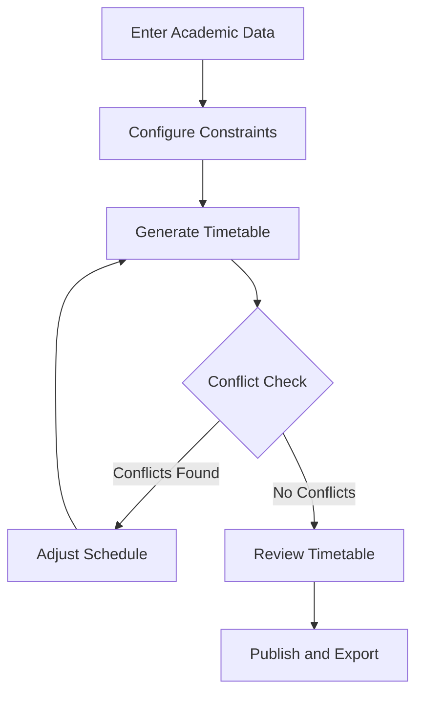

# 🗓️ Slotify

### Smart College Timetable Generator

**Slotify** is a smart timetable management system designed to simplify academic scheduling, prevent conflicts, and organize faculty, classrooms, laboratories, and subjects in one place.

> Less Scheduling. More Learning.

---

## ✨ Features

- 🧠 **Smart Scheduling** — Generate timetables using scheduling constraints.
- ⚠️ **Conflict Detection** — Detect faculty, classroom, and lecture clashes.
- 👨‍🏫 **Faculty Management** — Manage subjects, availability, and workload.
- 🏫 **Room Allocation** — Assign classrooms and labs efficiently.
- 📅 **Academic Calendar** — Manage holidays, breaks, and working days.
- 📝 **Manual Editing** — Modify schedules and lock important sessions.
- 📊 **Analytics Dashboard** — View faculty workload and room utilization.
- 📤 **Export Timetables** — Support for PDF, Excel, and CSV exports.
- 🔔 **Notifications** — Track timetable changes and updates.
- 👥 **Multiple Divisions** — Manage different classes and batches.

## 🔄 How It Works



## 🎨 Design

Slotify combines **Swiss Grid Minimalism** with a modern campus-inspired theme.

- 🌿 Forest green and warm cream palette
- 🎨 Soft pastel timetable blocks
- ▢ Clean grids, rounded corners, subtle borders
- 📱 Responsive and intuitive interface

## 🛠️ Tech Stack

The final stack will be documented according to the implemented project.

- **Frontend:** To be finalized
- **Backend:** Existing scheduling engine
- **Database:** To be finalized
- **Scheduling:** Constraint-based optimization
- **Tools:** Git and GitHub

## 🚀 Getting Started

### Prerequisites

- Git
- Required language runtime and dependencies
- Database, if required by the implementation

### Installation

```bash
git clone <YOUR-REPOSITORY-URL>
cd Slotify
```

Install dependencies and configure environment variables according to the project setup instructions.

Start the frontend and backend using the commands specified in their respective configuration files.

## 📁 Project Structure

```text
Slotify/
├── frontend/
├── backend/
├── scheduler/
├── database/
├── tests/
├── .env.example
└── README.md
```

*Illustrative structure; update it to match the actual repository.*

## 🔮 Future Enhancements

- Role-based access for admins, faculty, and students
- Substitute faculty management
- Timetable version history and approvals
- Advanced scheduling optimization
- Automated schedule-change notifications

## 🤝 Contributing

Suggestions, bug reports, and improvements are welcome. Feel free to open an issue or submit a pull request.

## 📄 License

A license is yet to be selected. Confirm the original repository's licensing terms before redistributing modified code.

---

<p align="center">
  <b>Slotify 🗓️</b><br/>
  Less Scheduling. More Learning.
</p>
